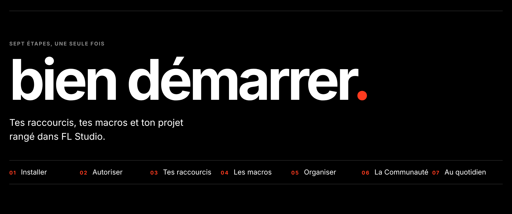
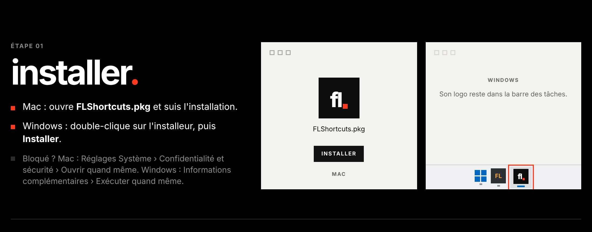
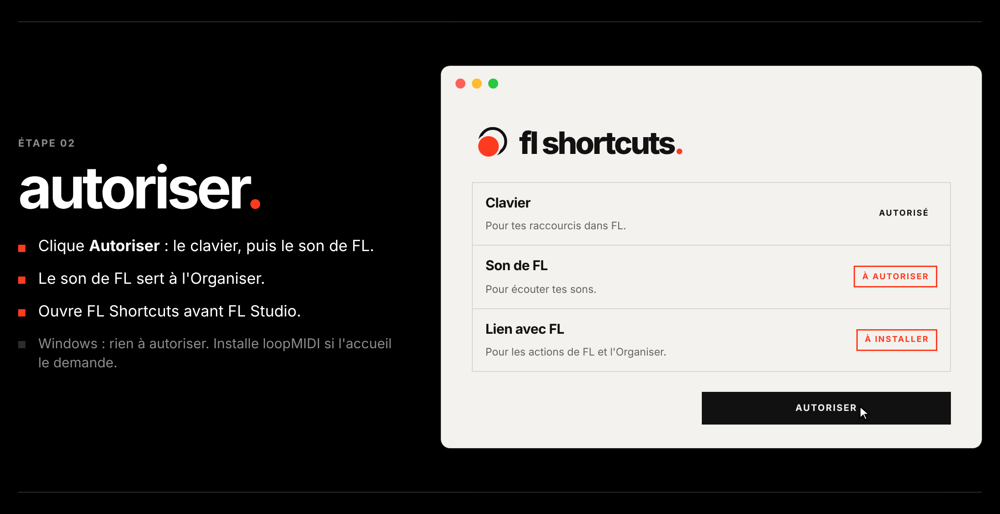
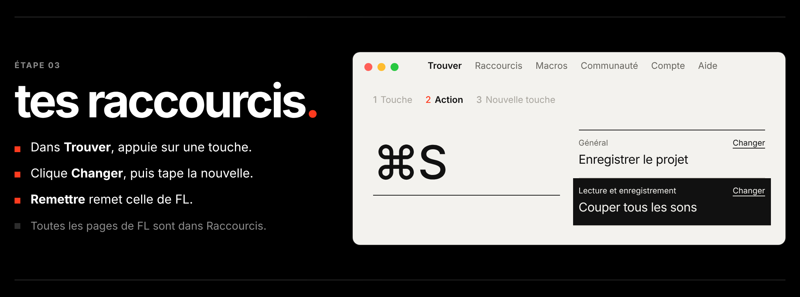
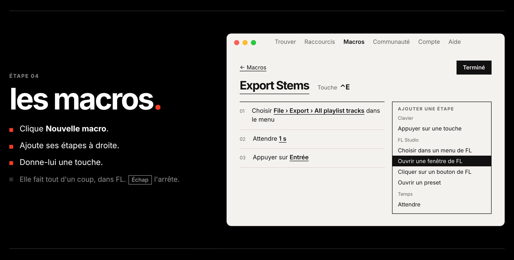
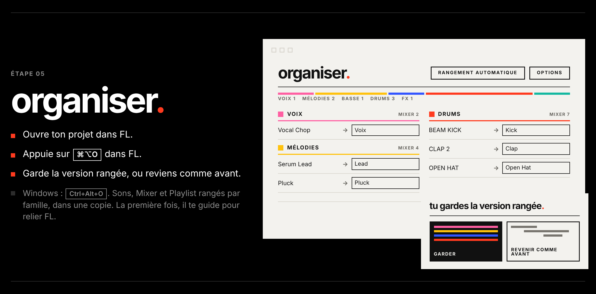
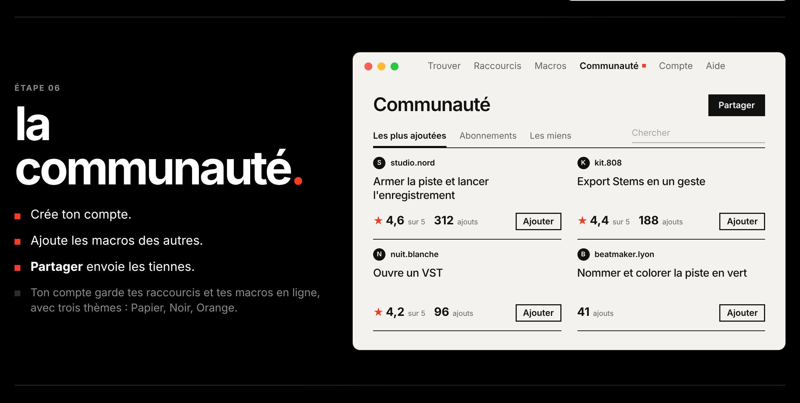
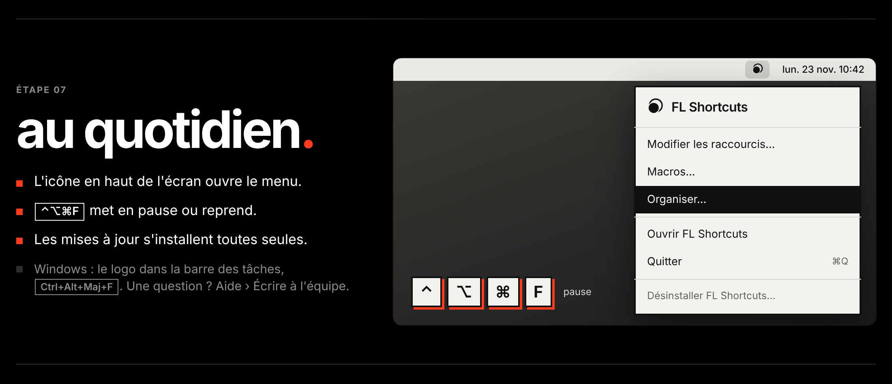

# FL Shortcuts

[](site/tuto.html)

Tes raccourcis, tes macros et ton projet rangé dans **FL Studio**. Sur **Mac** et **Windows**, gratuit.

> Outil indépendant, non affilié à Image-Line. « FL Studio » est une marque d'Image-Line.

## Télécharger

Sur la [page des versions](../../releases/latest) :

| | Fichier | Système |
|---|---|---|
| **Mac** | `FLShortcuts.pkg` | macOS 13 ou plus récent, Apple Silicon et Intel |
| **Windows** | `FLShortcuts-Windows-Setup.exe` | Windows 10 ou 11 |

Chaque téléchargement a son mode d'emploi illustré : `LISEZMOI.html` en français, `README.html` en anglais.
Le même tuto en page web : [site/tuto.html](site/tuto.html).

## En 7 étapes

### 1. Installer
[](site/tuto.html#installer)

- **Mac** : ouvre `FLShortcuts.pkg` et suis l'installation. Si macOS la bloque : *Réglages Système › Confidentialité
  et sécurité › Ouvrir quand même*, seulement pour un fichier venu de la page des versions.
- **Windows** : double-clique sur l'installeur, puis **Installer**. Si Windows affiche « Windows a protégé votre
  ordinateur » : *Informations complémentaires › Exécuter quand même*.

### 2. Autoriser
[](site/tuto.html#autoriser)

- **Mac** : clique **Autoriser**. Le clavier d'abord (*Accessibilité*), puis le son de FL (*Enregistrement de l'écran
  et audio du système*), qui sert à l'Organiser.
- **Windows** : rien à autoriser. Si l'accueil le demande, **Installer loopMIDI**.
- Ouvre FL Shortcuts avant FL Studio.

### 3. Tes raccourcis
[](site/tuto.html#raccourcis)

- **Trouver** : appuie sur une touche, tu vois ce qu'elle fait dans FL. Ou tape son nom.
- **Changer**, puis tape la nouvelle touche. Elle passe en rouge. **Remettre** remet celle de FL.
- **Raccourcis** : toutes les pages de FL (Playlist, Piano roll, Channel rack, Mixer…) et *Mes raccourcis*.

### 4. Les macros
[](site/tuto.html#macros)

- **Nouvelle macro**, puis ajoute ses étapes à droite. Elles se lisent comme des phrases : appuyer sur une touche,
  choisir dans un menu de FL, ouvrir une fenêtre, cliquer sur un bouton, ouvrir un preset, renommer la piste,
  attendre…
- Donne-lui une touche : elle fait tout d'un coup, dans FL. **Échap** l'arrête.

### 5. Organiser
[](site/tuto.html#organiser)

- Ouvre ton projet dans FL, puis **⌘⌥O** sur Mac, **Ctrl+Alt+O** sur Windows (ou menu de l'icône › *Organiser…*).
- FL Shortcuts lit ton projet et écoute tes sons. Il les range par famille (Voix, Drums, Basse, Mélodies, FX) :
  Channel rack, Mixer et Playlist, avec leurs couleurs, leurs noms et leurs icônes. Tu peux tout changer avant.
- Tout est rangé dans une copie, `<projet>_2.flp`. **Garder**, ou **Revenir comme avant** : l'original revient tel quel.
- La première fois, l'Organiser te guide pour relier FL (voir plus bas).

### 6. Communauté et compte
[](site/tuto.html#communaute)

- **Communauté** : ajoute les macros et les raccourcis des autres, suis les gens, note leur travail. **Partager**
  envoie les tiens.
- **Compte** : tes raccourcis et tes macros sauvegardés en ligne, et trois thèmes (Papier, Noir, Orange).
- **Aide** : les questions courantes, et **Écrire à l'équipe**. Les réponses arrivent dans *Mes messages*.

### 7. Au quotidien
[](site/tuto.html#quotidien)

- **Mac** : l'icône en haut de l'écran ouvre le menu. **Windows** : le logo dans la barre des tâches.
- **⌃⌥⌘F** (Mac) ou **Ctrl+Alt+Maj+F** (Windows) met en pause ou reprend.
- Les mises à jour s'installent toutes seules, quand FL est fermé.
- Pour désinstaller : menu de l'icône › *Désinstaller FL Shortcuts…* Rien ne reste.

---

## Relier FL Studio (une fois)

Le lien sert à l'Organiser et à quelques actions (nom et couleur d'une piste…). Tes raccourcis marchent sans lui.
FL Shortcuts pose tout seul son script dans FL. Si FL ne répond pas, l'Organiser te le dit : dans FL,
*Options › MIDI Settings*, règle ces 4 cases.

| | Où | Quoi |
|---|---|---|
| **1** | *Output*, ligne « FL Shortcuts Link » (Windows : « FL Shortcuts »), clique-la d'abord | **Port** : un numéro, par exemple 7 |
| **2** | *Input*, même nom, clique-la d'abord | **Enable** allumé |
| **3** | *Input*, même ligne | **Controller type** : « FL Shortcuts » |
| **4** | *Input*, même ligne | **Port** : **le même numéro** qu'en 1 |

<details>
<summary><b>Toujours rien ?</b></summary>

- Quitte FL, puis rouvre-le : il ne voit le lien qu'à son ouverture.
- Ta carte son ou ton clavier MIDI doit avoir **un autre numéro de Port**.
- **Pas de « FL Shortcuts » dans Controller type** : compare le dossier indiqué par FL Shortcuts avec
  *Options › File settings › User data folder* dans FL.
- Windows : loopMIDI doit être installé (rien à faire dedans), sauf sur Windows 11 25H2 et plus récent.
</details>

## Configuration

| | Mac | Windows |
|---|---|---|
| Système | macOS 13 ou plus récent (écoute de l'Organiser : macOS 14.2) | Windows 10 (1809+) ou 11, x64 ou ARM64 |
| FL Studio | 20.7 → 2025 et suivants | idem |
| Où vit l'appli | barre des menus | barre des tâches |
| Organiser | `⌘⌥O` dans FL | `Ctrl+Alt+O` dans FL |
| Pause | `⌃⌥⌘F` | `Ctrl+Alt+Maj+F` |

## Vie privée

- Le clavier n'est lu **que quand FL Studio est devant**. Aucune frappe n'est gardée ni envoyée.
- Le son de FL n'est écouté que pendant l'Organiser, sur ton ordinateur. Il n'est jamais envoyé.
- Le réseau sert au compte, à la Communauté, à la sauvegarde, aux messages à l'équipe et aux mises à jour.
- Détails : [confidentialité et mentions légales](web/public/confidentialite.html).

---

## Pour les développeurs

| | Commande | Où |
|---|---|---|
| Script FL (tests) | `python3 -m unittest discover -s Tests/python` | partout (Python 3.6+) |
| Cœur Windows (tests) | `dotnet test windows/FLShortcut.Core.Tests` | partout (.NET 8) |
| Site (tests) | `cd web && npm test` | partout (Node 18+) |
| App Mac | `./build.sh` | Mac avec Xcode |
| App Windows | `dotnet publish windows/FLShortcut.App -c Release -r win-x64 -p:Platform=x64` | Windows avec .NET 8 |

Sans Mac ni PC : chaque envoi sur GitHub lance [build.yml](.github/workflows/build.yml) (tests, `.pkg`, installeur
Windows, photos de l'app). Un tag `vX.Y.Z` publie une version et sa mise à jour signée
([docs/mises-a-jour.md](docs/mises-a-jour.md)).

```
Sources/FLShortcut/        app Mac (SwiftUI)
windows/                   app Windows (WinUI 3) et son cœur commun (C#)
Resources/                 script de FL (device_FLShortcut.py), textes, polices, IA (Core ML)
ia/                        IA qui reconnaît les sons (apprentissage, modèle ONNX, crédits)
supabase/                  serveur du compte et de la Communauté (SQL)
web/                       site public (Cloudflare) ; site/ : tuto et ancienne page de téléchargement
docs/                      modes d'emploi, maquettes, notes de travail
PROTOCOL.md                lien avec FL : trames signées, table des actions
```
