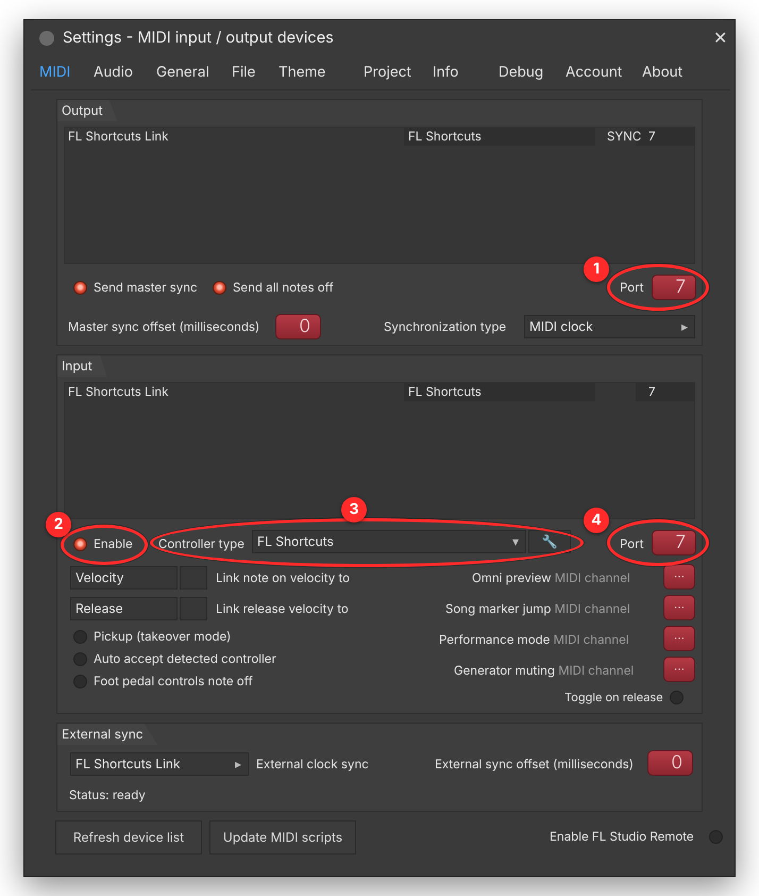

# FL Shortcuts

Tes propres raccourcis clavier pour **FL Studio**, sur **Mac** et **Windows**.

FL Studio n'a pas d'éditeur de raccourcis. FL Shortcuts en ajoute un : quand FL Studio est au premier plan, il reconnaît tes raccourcis et envoie à FL **ses propres touches** (Mixer, Playlist, REC, métronome, pattern suivant…). Les raccourcis marchent **sans rien installer dans FL**. Pour l'**Organiser** et quelques actions (mute / solo de piste, nom et couleur…), un petit lien se règle une fois, en une minute : voir [Relier FL Studio](#relier-fl-studio-pas-à-pas).

- **Macros** (Mac, version de test) : *Enregistrement rapide* charge un état de piste du Mixer, arme la piste, choisit l'entrée et lance le REC, d'un seul raccourci. Voir [MACROS.md](MACROS.md).
- **Mode MIDI** (facultatif, pour les utilisateurs avancés) : 40 actions via un script authentifié (mute / solo de piste, volume…). Désactivé par défaut.

> Outil indépendant, non affilié à Image-Line. « FL Studio » est une marque d'Image-Line.

| | Mac | Windows |
|---|---|---|
| Système | macOS 13 ou plus récent (Liquid Glass sur macOS 26) | Windows 10 (1809+) ou 11, x64 ou ARM64 |
| FL Studio | 20.7 → 2025 et suivants (actions grisées si ta version est trop ancienne) | idem |
| Où vit l'appli | barre des menus | zone de notification |
| Pause | `⌃⌥⌘F` | `Ctrl+Alt+Maj+F` |

---

## Installation

**Télécharge la dernière version** sur la [page des versions](../../releases/latest) (ou la page de téléchargement du projet, qui choisit le bon fichier toute seule).

### Mac : `FLShortcuts.dmg`

1. Ouvre `FLShortcuts.dmg` et glisse **FL Shortcuts** dans **Applications**, puis lance-le. Il s'installe dans la barre des menus.
2. **Autoriser le clavier** : clique sur *Autoriser…* ; l'appli ouvre *Réglages Système › Confidentialité et sécurité › Accessibilité*. Active FL Shortcuts.

C'est tout. Si macOS dit qu'il ne peut pas vérifier l'appli (version non notarisée) : *Réglages Système › Confidentialité et sécurité*, tout en bas, **Ouvrir quand même**. Fais-le seulement pour un fichier venu de la page officielle des versions, dont l'empreinte SHA-256 correspond.

Pour désinstaller : menu de l'icône FL Shortcuts en haut de l'écran › *Désinstaller FL Shortcuts…* (aussi dans le menu ⋯ de la fenêtre). Tout est retiré, et le bilan dit s'il reste quelque chose à glisser dans la Corbeille.

### Windows : `FLShortcuts-Windows-Setup.exe`

1. Double-clique sur l'installeur, puis **Installer**. Aucun droit administrateur demandé, x64 et ARM dans le même fichier.
2. FL Shortcuts se lance et se range dans la zone de notification. Il démarre avec Windows (décochable dans l'installeur).

C'est tout. Si Windows affiche « Windows a protégé votre ordinateur » (installeur non signé) : **Informations complémentaires › Exécuter quand même**. Désinstallation : *Paramètres › Applications*. Une version portable (`.zip`) existe aussi. Ne lance pas FL Studio en administrateur.

---

## Relier FL Studio (pas à pas)

À faire une seule fois, pour l'Organiser et les actions qui passent par le lien.

1. **Installe le lien** : à la première ouverture de FL Shortcuts (écran « Relier FL Studio »), ou plus tard par le menu de l'icône en haut de l'écran › *Installer le lien avec FL Studio…*
2. **Quitte FL complètement** (`⌘Q` sur Mac, la croix sur Windows), puis **rouvre-le** : c'est en démarrant qu'il trouve le lien.
3. Dans FL : **Options › MIDI Settings**.
4. Règle les **4 cases entourées en rouge** :



| | Où | Quoi |
|---|---|---|
| **1** | *Output*, ligne « FL Shortcuts Link » (clique-la d'abord) | **Port** : un numéro, par exemple 7 |
| **2** | *Input*, ligne « FL Shortcuts Link » (clique-la d'abord) | **Enable** allumé |
| **3** | *Input*, même ligne | **Controller type** : « FL Shortcuts » |
| **4** | *Input*, même ligne | **Port** : **le même numéro** qu'en 1 |

C'est fait quand FL Shortcuts affiche **« FL Studio est relié »**.

**Toujours rien ?**
- Ta carte son (ou ton clavier MIDI) doit avoir **un autre numéro de Port** : FL répond à la première sortie de ce numéro.
- **Pas de « FL Shortcuts » dans Controller type** : FL ne lit pas le dossier où est le lien. Compare le dossier indiqué par FL Shortcuts avec *Options › File settings › User data folder* dans FL (pas sur iCloud).
- Mac : *Réglages Système › Confidentialité et sécurité › Fichiers et dossiers › FL Studio* : coche **Dossier Documents**.

---

## Profils fournis

Le profil **Recommandé** n'écrase aucun raccourci de FL. Tu peux changer de profil à tout moment (c'est annulable), en importer un ou exporter le tien.

| Action | Mac | Windows |
|---|---|---|
| Playlist, Channel Rack, Piano Roll, Mixer, Browser | `⌃1` … `⌃5` | `Ctrl+Maj+1` … `5` |
| Pattern précédent / suivant | `⌃D` / `⌃F` | `Ctrl+Maj+D` / `F` |
| Mute / Solo de la piste du Mixer (mode MIDI seulement) | `⌃T` / `⌃S` | `Ctrl+Maj+T` / `G` |
| Métronome | `⌃M` | `Ctrl+Maj+K` |
| Rétablir (mode MIDI seulement) | `⇧⌘Z` | `Ctrl+Y` |

- **Ableton dans FL** (Mac) : les raccourcis par défaut d'Ableton Live 12 font la même chose dans FL, chacun envoyé comme la touche de FL équivalente (sans le script) : `F9` enregistre, `⌘D` duplique, `⌘E` découpe, `⌘J` consolide, `⌘U` quantize, `⌘R` renomme, `0` coupe le son de la sélection, `B` dessine, `O` métronome, `⌘4` magnétisme, `⌘+` / `⌘−` / `Z` zooment, `⌘⌥B` Browser, `⌘⌥M` Mixer, `⇧⇥` Piano Roll, `⌘Z` annule pas à pas. Contient des touches seules.
- **Logic Pro dans FL** (Mac) : pareil avec les raccourcis par défaut de Logic Pro : `↩` revient au début, `K` métronome, `X` Mixer, `P` Piano Roll, `F` Browser, `Y` instruments et effets, `T` outils, `Q` quantize, `⌘T` découpe, `⌘R` répète, `⌘J` joint, `⌃M` coupe le son des clips, `⌘←` / `⌘→` / `Z` zooment, `,` / `.` changent de mesure, `⌘K` clavier musical, `⌘B` exporte. Contient des touches seules.
- **Vide** part de zéro.

Sur Windows, on évite `Ctrl+Alt` : c'est AltGr sur les claviers AZERTY (`@`, `€`, `{`…). L'appli prévient quand un raccourci :
- entre en conflit avec FL ;
- est déjà pris ;
- est une touche seule ;
- demande une version de FL plus récente.

### Limites connues

- Mute et Solo agissent sur la piste du Mixer sélectionnée. L'API de FL ne donne pas accès aux clips sélectionnés de la Playlist.
- Les raccourcis s'appliquent aussi dans les fenêtres de plugins de FL. En cas de conflit, mets FL Shortcuts en pause.
- Une touche seule (sans ⌘ ⌃ ⌥) lance son raccourci, sauf quand FL s'en sert : menu de FL ouvert, boîte de FL devant (renommer, taper une valeur…), champ de texte, clavier-piano actif (coche lue dans le menu Options de la barre de macOS, FL 2024.2 et plus). Une saisie faite directement dans la fenêtre principale de FL, sans boîte ni champ visible par l'Accessibilité, n'est pas reconnue : ajoute alors ⌃ au raccourci.

---

## Macros (sans MIDI)

Une **macro** enchaîne des clics et des touches dans FL, avec le même principe sûr que le mode léger : aucun script, aucun port MIDI, rien d'écrit dans FL. Les événements ne vont qu'au processus FL, et seulement quand il est au premier plan. Échap interrompt la macro.

Modèle livré, **Enregistrement rapide** (fiche d'un raccourci › Type › Macro) :

1. clic droit sur la piste du Mixer sous la souris, puis *File › Open mixer track state* ;
2. preset : la liste de FL s'ouvre et la macro attend ton choix, ou un preset (.fst) est choisi une fois dans FL Shortcuts et chargé directement ;
3. armement de la piste et première entrée (positions apprises une fois, en cliquant dans FL) ;
4. REC allumé à la fin (facultatif).

Bloc **Nom et couleur** (par le lien avec FL) : nomme et colore la piste ou le canal sélectionné dans la page de FL qui est devant (Mixer, Channel rack, Playlist), pour des macros d'organisation.

Détails, limites et mode d'emploi du diagnostic (`FLShortcut --diag-macro`) : [MACROS.md](MACROS.md).

---

## Sécurité et vie privée

- Le clavier n'est observé **que quand FL Studio est au premier plan**. Aucune frappe n'est enregistrée, journalisée ni envoyée. L'appli n'utilise pas le réseau.
- Les actions passent par des **trames MIDI signées** (HMAC-SHA256, nonce, anti-rejeu, limite de débit, liste blanche des 40 actions). Un autre logiciel qui écrit sur le port ne peut rien déclencher. Le protocole est décrit dans [PROTOCOL.md](PROTOCOL.md).
- La clé est rangée dans le **Trousseau** (Mac) ou protégée par **DPAPI** (Windows).
- Les écritures de fichiers sont atomiques, et les liens symboliques sont refusés. L'empreinte du script installé est vérifiée, et un script modifié est signalé.
- Les touches dangereuses (`⌘Q`, `Alt+F4`, `Win+…`…) sont refusées comme cibles, y compris dans un profil importé.
- Les audits complets sont dans [audit/](audit/) : sécurité, fiabilité, compatibilité des versions, ergonomie et relectures.

---

## Compiler

| | Commande | Où |
|---|---|---|
| Script FL (tests) | `python3 -m unittest discover -s Tests/python` | partout (Python 3.6+) |
| Cœur Windows (tests) | `dotnet test windows/FLShortcut.Core.Tests` | partout (.NET 8) |
| App Mac | `./build.sh` | Mac avec Xcode 16+ (Xcode 26 pour le Liquid Glass natif) |
| App Windows | `dotnet publish windows/FLShortcut.App -c Release -r win-x64 -p:Platform=x64` | Windows avec .NET 8 |
| Installeur Windows | `iscc /DAppVersion=1.0.0 /DDistDir=…\dist windows\installer\FLShortcut.iss` | Windows avec Inno Setup 6 |

**Sans Mac ni PC de développement :** pousse le dépôt sur GitHub. Le workflow [build.yml](.github/workflows/build.yml) :
- lance tous les tests ;
- compile le `.dmg` universel, l'installeur Windows (`FLShortcuts-Windows-Setup.exe`, x64 + ARM64) et les `.zip` portables, avec leurs empreintes SHA-256 et une attestation de provenance ;
- publie une *Release* à chaque tag `v*` (`git tag v1.0.0 && git push --tags`) ; les liens « latest » de la page de téléchargement suivent tout seuls.

**Page de téléchargement :** `site/index.html`, publiée par [pages.yml](.github/workflows/pages.yml) (à activer une fois : *Settings › Pages › Source : GitHub Actions*). Elle propose le bon fichier selon l'ordinateur du visiteur.

**Distribution sans avertissement :**
- **Mac** : il faut un compte Apple Developer. Ensuite, `SIGN_IDENTITY="Developer ID Application: …" NOTARY_PROFILE=… ./build.sh` signe, notarise et agrafe le ticket.
- **Windows** : il faut un certificat de signature de code (Authenticode), ou une publication via le Microsoft Store.

---

## Structure

```
Resources/device_FLShortcut.py   script MIDI côté FL Studio (Python 3.6+, FL 20.7 → 2025+)
PROTOCOL.md                      contrat commun : trames, HMAC, table des 40 actions
Sources/FLShortcut/              app Mac (SwiftUI) : interception (EventTap), routeur, MIDI (CoreMIDI),
                                 Trousseau, interface Liquid Glass (GlassStyle, EditorView, OnboardingView)
Tests/FLShortcutTests/           tests XCTest
windows/FLShortcut.Core/         cœur Windows portable (protocole, modèle, profils, routeur)
windows/FLShortcut.Core.Tests/   tests xUnit
windows/FLShortcut.App/          app WinUI 3 (Mica, Fluent 2) : hook clavier, injection, MIDI WinMM, DPAPI
Tests/python/                    tests du script FL (simulateur de l'API FL)
audit/                           rapports d'audit et de relecture
build.sh                         compilation, signature et notarisation Mac
```

**Ajouter une action FL :** donne-lui l'id suivant dans [PROTOCOL.md](PROTOCOL.md) §6, puis ajoute-la à ces trois endroits :
- `ACTIONS` dans `device_FLShortcut.py` ;
- `Actions.swift` ;
- `windows/FLShortcut.Core/Actions.cs`.

Les tests vérifient que les trois listes concordent. Les fonctions disponibles sont dans la [documentation de l'API Python de FL Studio](https://il-group.github.io/FL-Studio-API-Stubs/).
